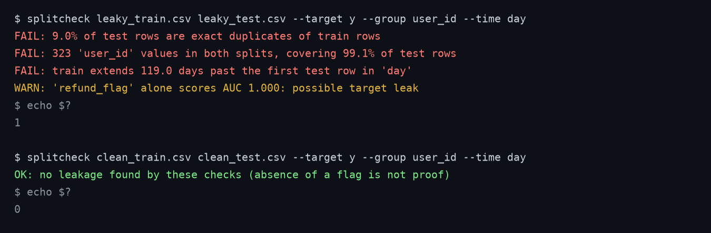
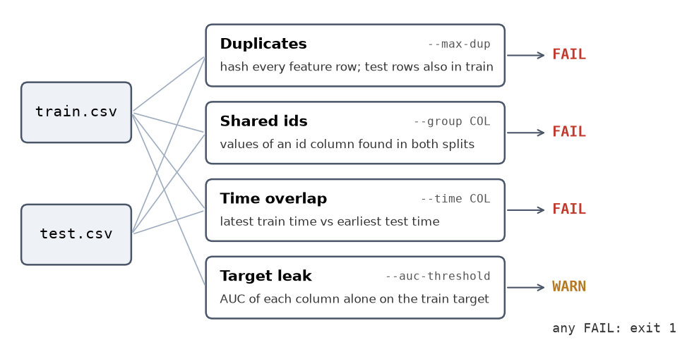

# splitcheck

[](https://github.com/aghasalim/splitcheck/actions/workflows/ci.yml)

A one-command check for the leaks that quietly inflate a model's test score. Give it your train and test CSVs and it tells you whether the split is clean. It exits non-zero on a failure, so it can gate CI.

```bash
pip install git+https://github.com/aghasalim/splitcheck
splitcheck train.csv test.csv --target y --group user_id --time created_at
```

```
FAIL: 9.1% of test rows are exact duplicates of train rows
FAIL: 181 'user' values in both splits, covering 83.3% of test rows
FAIL: train extends 25.0 days past the first test row in 'day'
WARN: 'score_after' alone scores AUC 1.000: possible target leak
```



A real run on a synthetic event log with four planted leaks (random row split, 50 copied rows, a column that equals the target), then on a clean user and time split of the same data. `python scripts/make_figures.py` rebuilds it.

## What it checks

| Check | Fails when | Flag |
|---|---|---|
| Duplicates | feature rows in test also appear in train | `--max-dup` (default 0) |
| Shared ids | a user, patient or session appears in both splits | `--group COL` (repeatable) |
| Time overlap | train has rows later than the first test row | `--time COL` |
| Target leak | one column alone predicts a binary target (AUC at or above 0.98, a warning) | `--auc-threshold` |



What each check reads. The target-leak check only looks at the training file.

## What it does not do

It finds leaks you can measure from the two files. It does not prove a split is clean: near-duplicates (a rescaled copy of a row), leaks through feature engineering done before the split, and multi-class or regression target leaks are not checked. A clean report means these checks passed, nothing more. The target-leak check is also optimistic on high-cardinality text columns, since it target-mean-encodes them on the training data.

## Use it as a library

```python
import splitcheck, pandas as pd
splitcheck.run(pd.read_csv("train.csv"), pd.read_csv("test.csv"), "y", groups=["user_id"])
```

It returns a list of `(severity, message)` pairs.

## Tests

`pytest -q` runs five tests, one per check plus a clean split that must pass.

MIT licence.
